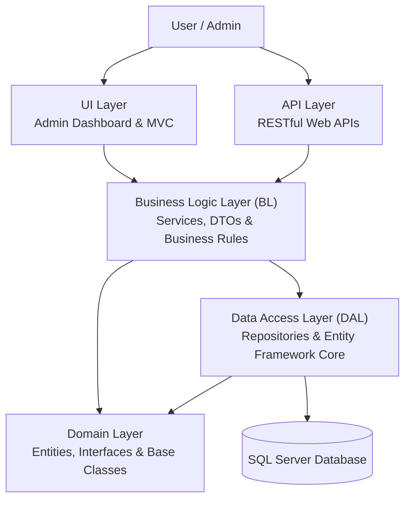

# ShippingSystem-CleanArchitecture
## Architecture Diagram

The following diagram illustrates the system's five-tier architecture and the flow of dependencies between its layers.

### Main Layers

| Layer | Responsibility |
|---|---|
| UI | Admin dashboard and user interface. |
| API | Exposes RESTful endpoints for clients. |
| BL | Handles business logic, services, and DTOs. |
| DAL | Handles database operations using repositories and Entity Framework Core. |
| Domain | Contains core entities, interfaces, and shared abstractions. |
