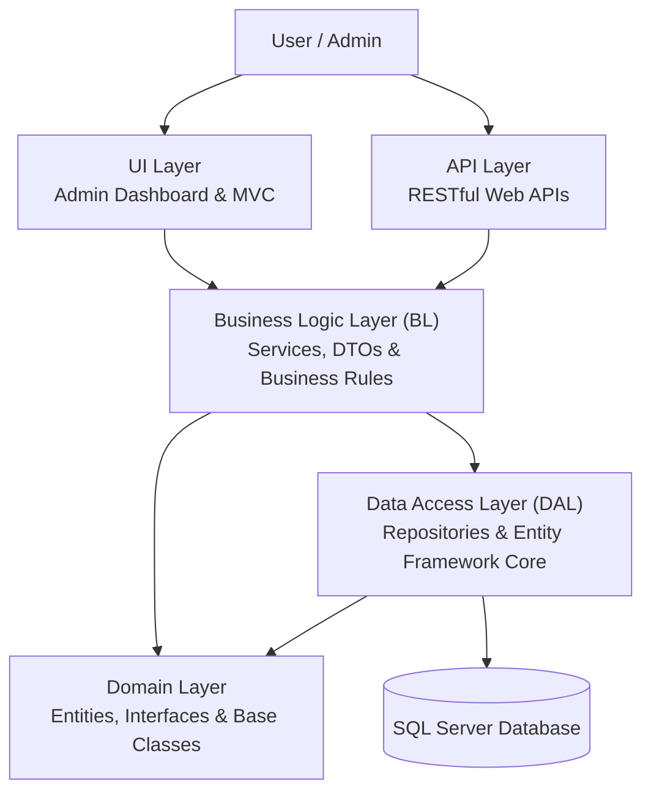
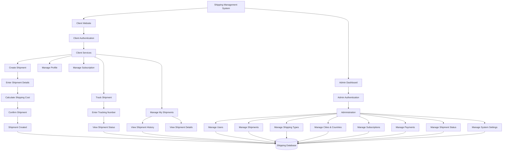
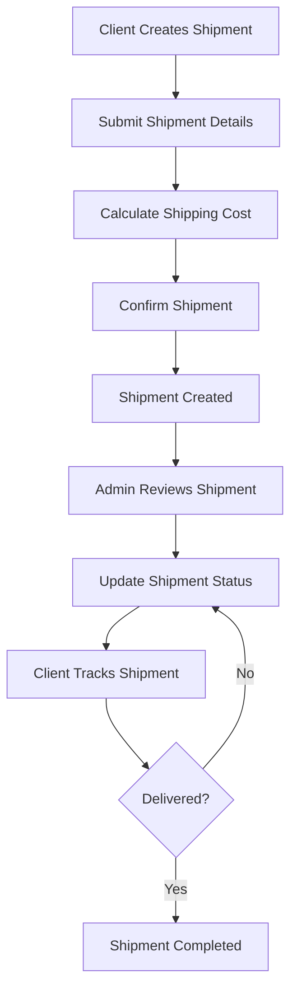

# ShippingSystem-CleanArchitecture

A Shipping Management System built with ASP.NET Core using a five-tier architecture and Clean Architecture principles. The system provides a complete platform for managing shipments, tracking deliveries, handling subscriptions, and managing users through a client website and an admin dashboard.

## Overview

ShippingSystem is a web-based platform designed to simplify shipping operations and improve shipment management.

It provides two main interfaces:

- **Client Website:** Allows customers to create shipments, track deliveries, manage their shipment history, and manage subscriptions.
- **Admin Dashboard:** Allows administrators to manage users, shipments, shipping types, locations, payments, subscriptions, and system settings.

The project focuses on maintainable code, separation of concerns, reusable components, and applying software design patterns.

## Key Features

### Client Website

- User registration and authentication.
- Create new shipments.
- Calculate shipping costs.
- Track shipments using tracking information.
- View shipment history and details.
- Manage personal profile.
- Manage subscriptions.
- View payment information.

### Admin Dashboard

- Admin authentication and authorization.
- Dashboard for managing shipping operations.
- View and manage all users.
- View and manage shipments.
- Manage shipping types.
- Manage cities and countries.
- Manage shipment statuses.
- Manage subscription packages.
- Manage payments.
- Manage system settings.

## Technologies Used

- **Programming Language:** C#
- **Backend:** ASP.NET Core MVC, ASP.NET Core Web API
- **Architecture:** Five-Tier Architecture, Clean Architecture Principles
- **Database:** SQL Server
- **ORM:** Entity Framework Core
- **Authentication:** ASP.NET Core Identity
- **Design Patterns:** Repository Pattern
- **Dependency Management:** Dependency Injection
- **API Documentation:** Swagger / OpenAPI
- **Frontend:** HTML, CSS, JavaScript, Bootstrap, Razor Views
- **Version Control:** Git and GitHub

## Architecture Diagram

The application follows a five-tier architecture to separate responsibilities and improve maintainability, scalability, and testability.

### Main Layers

| Layer | Responsibility |
|---|---|
| UI | Provides the web interface, MVC controllers, Razor views, and admin dashboard. |
| API | Exposes RESTful endpoints for client applications and external integrations. |
| BL | Contains business logic, services, DTOs, and application operations. |
| DAL | Handles database operations through repositories and Entity Framework Core. |
| Domain | Contains core entities, interfaces, and shared abstractions. |

## System Workflow Diagram

The following diagram illustrates how clients and administrators interact with the system and its main features.

## Shipment Lifecycle

This diagram demonstrates the shipment process, from creation by the client to delivery.

## Main System Modules

| Client Website | Admin Dashboard |
|---|---|
| Register and Login | Manage Users |
| Create Shipments | Manage Shipments |
| Track Shipments | Manage Shipment Status |
| View Shipment History | Manage Shipping Types |
| Manage Profile | Manage Cities and Countries |
| Manage Subscriptions | Manage Subscription Packages |
| View Payments | Manage Payments and Settings |

## Design Patterns & Principles

The project applies software engineering concepts to keep the code organized, reusable, and maintainable.

- **Repository Pattern:** Separates data access operations from business logic.
- **Dependency Injection:** Manages dependencies between application components.
- **Separation of Concerns:** Divides the application into layers with clear responsibilities.
- **Clean Architecture Principles:** Keeps core business concepts independent of infrastructure and presentation concerns.
- **DTO Pattern:** Transfers data between application layers without exposing database entities directly.

## Screenshots

Screenshots of the client website and admin dashboard will be added here.

<!-- Add screenshots of your actual application here. -->

## Project Goals

- Build a practical Shipping Management System using ASP.NET Core.
- Apply layered architecture and Clean Architecture principles.
- Practice implementing design patterns in a real-world project.
- Improve code organization and maintainability.
- Develop shipment tracking and management workflows.
- Gain practical experience with Entity Framework Core, SQL Server, and ASP.NET Core Identity.

## Future Improvements

- Add automated unit and integration tests.
- Improve shipment tracking and notifications.
- Add reporting and analytics to the admin dashboard.
- Enhance API security and documentation.
- Improve application performance and error handling.

## Author

**Haidy Abdo Mohamed Abdallah Gabal**

[GitHub Profile](https://github.com/haidyaGabal)

---

*This project is developed as a practical application of ASP.NET Core, software architecture, and object-oriented programming concepts.*
