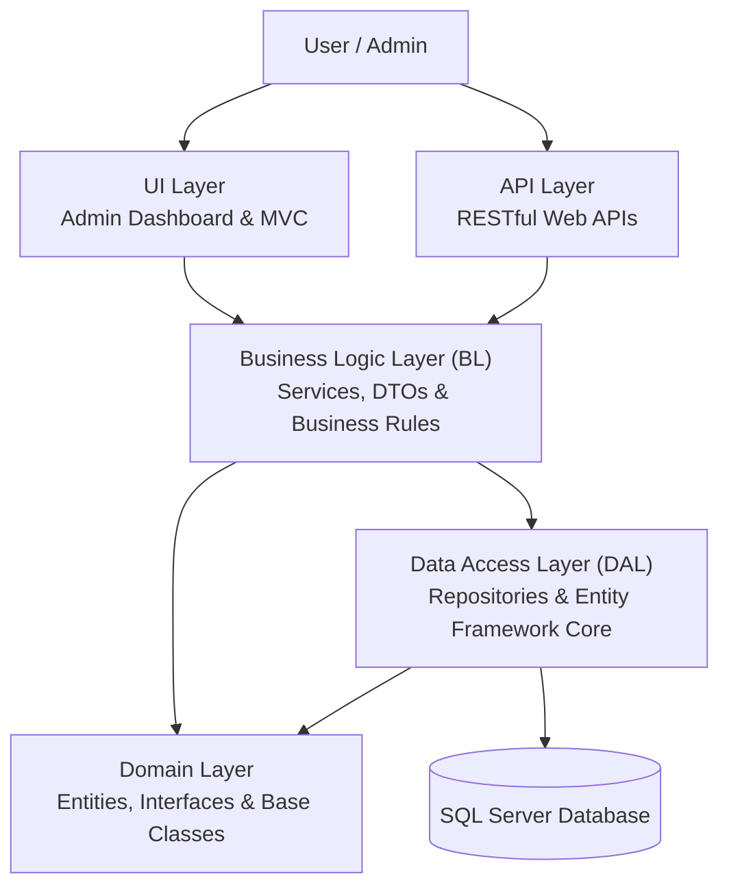
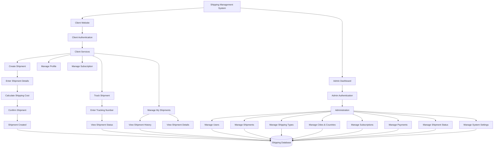

# ShippingSystem-CleanArchitecture
## Architecture Diagram

The following diagram illustrates the system's five-tier architecture and the flow of dependencies between its layers.

### Main Layers

| Layer | Responsibility |
|---|---|
| UI | Admin dashboard and user interface. |
| API | Exposes RESTful endpoints for clients. |
| BL | Handles business logic, services, and DTOs. |
| DAL | Handles database operations using repositories and Entity Framework Core. |
| Domain | Contains core entities, interfaces, and shared abstractions. |

## System Workflow Diagram

The following diagram illustrates the main workflows of the Shipping Management System, showing the interactions between clients, administrators, and the system's core features.

### Main System Modules

| Client Website | Admin Dashboard |
|---|---|
| Register and Login | View and manage all users |
| Create shipments | View and manage all shipments |
| Track shipments | Manage shipment statuses |
| View shipment history | Manage shipping types |
| Manage profile | Manage cities and countries |
| Manage subscriptions | Manage subscription packages |
| View payments | Manage payments and settings |

